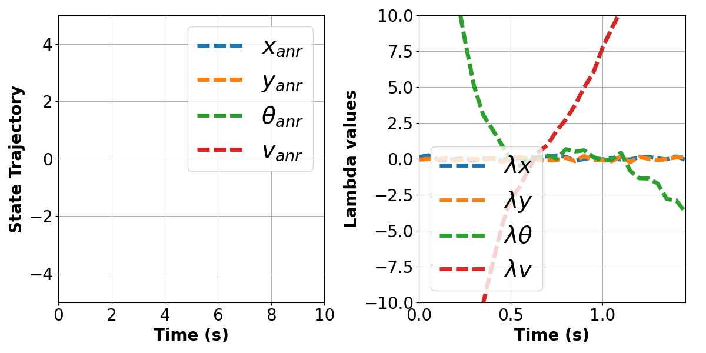
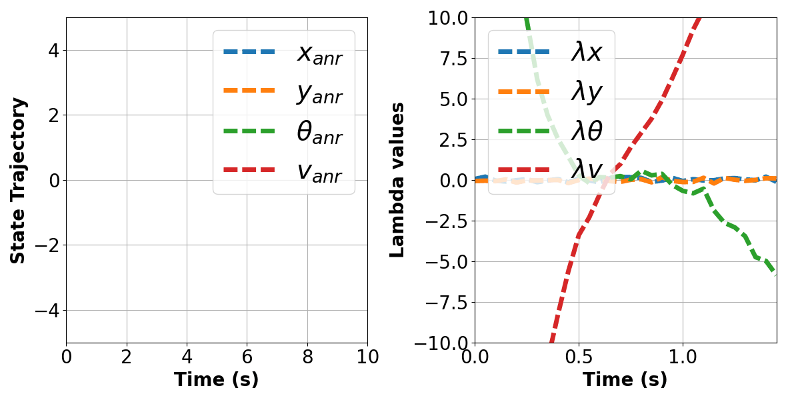
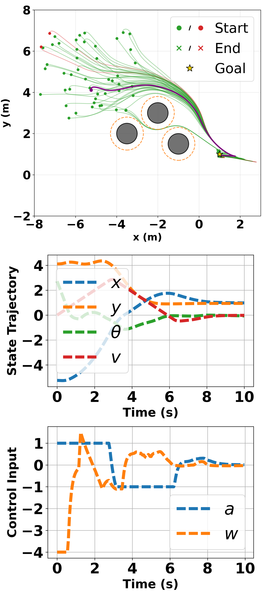
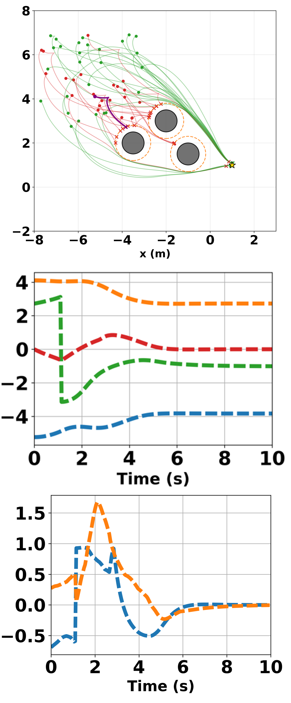
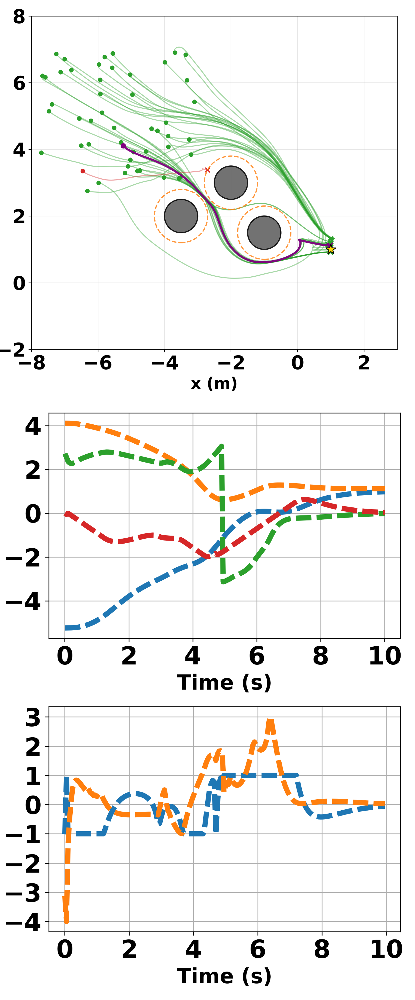
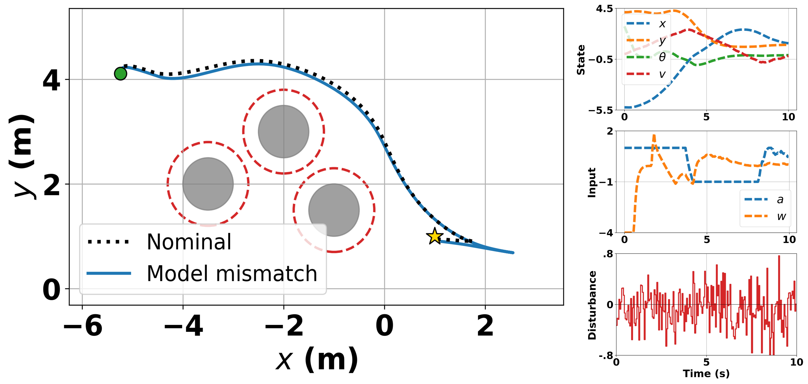

# Overview
This repository contains the code for the paper "An Adjoint-based Neural Regulator for Safe Real-Time Optimal Control."

## Results

### **Scenario 1:  Without Obstacles navigation trajectories for CASE C for ANR, RL-QC, RL-PB, and MPC**


<p align="center">
   
   
   
   
</p>
<p align="center">
   
</p>

**Figure 2:** Out-of-distribution comparison with a nonzero reference for 100 randomly sampled initial states. **Top left** = ANR, **Top right** = RL-QC, **Bottom left** = RL-PB, **Bottom right** = MPC-IPOPT. The animation  shows the evolution of the ANR costates.


### **Scenario 2: State and Control Trajectories with Obstacles for ANR, RL, and MPC**

**Case B: Unseen initial conditions and zero reference**
<p align="center">
 
  
  
</p>
<p align="center">
   
</p>
 **Figure 3:** Constrained out-of-distribution evaluation: Top trajectories for 50 random initial states and Bottom state and control input trajectories for a representative case (in purple). **Left** = ANR, **Middle** = RL-PB, **Right** = MPC-IPOPT. The animation shows the evolution of the ANR costates.

**Case C: Unseen initial conditions and nonzero reference**
<p align="center">
 
  
  
</p>
<p align="center">
   
</p>

**Figure 4:** Constrained out-of-distribution evaluation: Top trajectories for 50 random initial states and Bottom state and control input trajectories for a representative case (in purple). **Left** = ANR, **Middle** = RL-PB, **Right** = MPC-IPOPT. The animation shows the evolution of the ANR costates.


## Run Locally

### Setup

From the repository root, create an environment using Python 3.10 and install the packages for ANR, MPC-IPOPT, and RL. The following commands use PowerShell:

```powershell
python -m venv .venv
.\.venv\Scripts\Activate.ps1
python -m pip install -r requirements.txt
```

SQP-RTI additionally requires acados and its build tools (I will see if i can create additional guidance on this)

ANR evaluation loads checkpoints from `ANR/model/`. RL evaluation loads policies from `RL_SAC_HOCBF/output/Unicycle-run*/`.
### Scripts and working directories

Run benchmark generators from the repository root. For the scripts below, use `cd .\ANR` for ANR/MPC and `cd .\RL_SAC_HOCBF` for RL, then run `python <script_name>`. Use `cd ..` to return to the repository root before switching folders.

 - `config.py` is the file that stores the values of used parameters such as sampling time (dt), prediction horizon (N), range of Safety constraints, etc.
 - `mpc_controller.py` defines the Model Predictive Control (MPC) class.
 - run `train.py` to train the Co-state Neural Network (CoNN) used in Adjoint-based Neural Regulator (ANR).
 - run `sim_ANR.py` and `sim_mpc.py` to generate simulation results using ANR and MPC, respectively.
 - run `sim_ANR_random_init_case_c.py` to see the performance of ANR evaluated over 100 initial states (**Obstacle-Free Scenarios, CASE C**).
 - run `sim_MPC_ipopt_random_init_case_c.py` to see the performance of MPC evaluated over 100 initial states (**Obstacle-Free Scenarios, CASE C**).
 - run `sim_Rl_random_init_case_c.py` to see the performance of RL evaluated over 100 initial states  (**Obstacle-Free Scenarios, CASE C**).

 - run `sim_ANR_case_b_obs.py`, `sim_ANR_case_c_obs.py` to see the performance of ANR evaluated over 50 trials on constrained out-of-distribution settings for case B and Case C, respectively (**Obstacles-Laden Scenarios**). 
 - run `sim_MPC_ipopt_case_b_obs.py`, `sim_MPC_ipopt_case_c_obs.py`  to see the performance of MPC-ipopt evaluated over 50 trials on constrained out-of-distribution settings for Case B and Case C, respectively (**Obstacles-Laden Scenarios**). 
 - run `sim_Rl_random_b_obs.py`, `sim_Rl_random_c_obs.py` to see the performance of RL evaluated over 50 trials on constrained out-of-distribution settings for Case B and Case C, respectively (**Obstacles-Laden Scenarios**). 
 - run `compare_ANR_case_c_obs.py` to generate overlays comparing nominal ANR behavior with ANR behavior under mass mismatch and disturbance for Case C with obstacles.

Before running a benchmark evaluator, generate its matching dataset if it is missing. From the repository root, run `python` with one of these scripts: `generate_case_a_benchmark.py`, `generate_case_b_benchmark.py`, `generate_case_c_benchmark.py`, `generate_case_b_obstacle_benchmark.py`, or `generate_case_c_obstacle_benchmark.py`. For example:

```powershell
python generate_case_c_obstacle_benchmark.py
python ANR/sim_ANR_case_c_obs.py
```

**Note: For RL, use run1 for RL-QC and run2 for RL-PB evaluation.**


## RL training and deployment

Each command block below starts from the repository root. If you are already in `RL_SAC_HOCBF`, omit the `cd` line.


## The objectives are

1. Train a Unicycle RL policy with no obstacles.
2. Deploy/test that policy with obstacles and a CBF safety filter.

## Supported scope

- Environment: `Unicycle` only
- Modes: `train`, `test`
- CBF modes: `off` (train), `baseline` (deploy/test)

## Main workflow

Notes:
- If `--resume` is a number (for example `1`), it resolves to `output/Unicycle-run1`. **Use run1 for RL-QC and run2 for RL-PB evaluation.**
- Saved model files are under `output/Unicycle-run*/`.
- Effective HOCBF/animation obstacle boundary is `r_eff = obstacle_radius + robot_r + safety_margin`.

## To Run Locally

## For training 
```powershell
cd .\RL_SAC_HOCBF
python main.py --mode train --env_name Unicycle --cbf_mode off --obs_config none --rand_init True --init_mode grid --init_grid_n 10 --init_x_min -2 --init_x_max 2 --init_y_min -2 --init_y_max 2 --init_theta_min -2 --init_theta_max 2 --init_v_min -2 --init_v_max 2 --zref_x 0 --zref_y 0 --zref_theta 0 --zref_v 0 --seed 12345 

```

## Deployment
Test zero-shot transfer with specified obstacles and HOCBF safety enabled:

You can save a matplotlib animation of the unicycle rolling along its path by adding the `--save_anim` flag (and optionally `--anim_name`/`--initial_state_option`). The file will be written to `./animation/unicycle/<anim_name>_<episode>.mp4`.

## Case B: unseen initial state with obstacles

```powershell
cd .\RL_SAC_HOCBF

python .\main.py --mode test --env_name Unicycle --resume 2 --cbf_mode baseline --obs_config none --rand_init False --obs_circles="-4.0,2,0.5; -1.5,1.5,0.5; -2.5,3,0.5" --z0_x -5.24 --z0_y 4.11 --z0_theta 2.72 --z0_v 0 --zref_x 0 --zref_y 0 --zref_theta 0 --zref_v 0 --eval_horizon_steps 200 --terminate_on_goal_eval False --disturbance_enabled False --disturbance_velocity_std 0.3 --disturbance_seed 10 --validate_episodes 1 --save_anim --anim_name RL-PB_with_obs_caseB --save_final_shot --final_shot_name RL_PB_finalshot_with_obs_caseB --save_traj_plots --traj_plot_name RL_PB_MSD_with_obs_caseB --traj_plot_dir .\figs\diagnostics --initial_state_option b --seed 12345 --qp-solver qpoases 
```

### Case C: unseen initial state, nonzero reference, with obstacles

```powershell
cd .\RL_SAC_HOCBF

python .\main.py --mode test --env_name Unicycle --resume 2 --cbf_mode baseline --obs_config none --rand_init False --obs_circles="-3.5,2,0.5; -1,1.5,0.5; -2,3,0.5" --z0_x -5.24 --z0_y 4.11 --z0_theta 2.72 --z0_v 0 --zref_x 1 --zref_y 1 --zref_theta 0 --zref_v 0 --robot_r 0.25 --cbf_buffer 0.05 --eval_horizon_steps 200 --terminate_on_goal_eval False --disturbance_enabled False --disturbance_velocity_std 0.3 --disturbance_seed 10 --validate_episodes 1 --save_anim --anim_name RL_PB_with_3obs_caseC --save_final_shot --final_shot_name RL_PB_finalshot_with_3obs_caseC --save_traj_plots --traj_plot_name RL_PB_MSD_with_3obs_caseC --traj_plot_dir .\figs\diagnostics --initial_state_option c --seed 12345 --qp-solver qpoases
```

**NOTE:** use (z0_x, z0_y, z0_theta, z0_v) to define the initial states you want and (zref_x, zref_y, zref_theta, zref_v) to define the reference


# Model Mismatch
In [`ANR/config.py`](ANR/config.py), configure disturbance and mass variation independently:

`nominal_mass` is the mass assumed by the controller; `mass` is the simulated plant mass. Keeping the controller's assumed mass at `1.0` while increasing the plant mass to `1.4` creates model mismatch.

- Set `disturbance_enabled = True` to enable disturbance or `disturbance_enabled = False` to disable it.
- Set `mass = 1.4` for the mass mismatch case or `mass = 1.0` for the nominal mass case. Keep `nominal_mass = 1.0` in both cases.

Then follow the `Run Locally` instructions for the scenario you wish to evaluate.

For the direct RL `main.py` commands above, set disturbance using `--disturbance_enabled True` or `False`. The ANR comparison script configures both nominal and perturbed runs itself; use `--deployment-mass` and `--sigma` to adjust its perturbed case.

### **With Obstacle State and Control trajectories, and disturbance plot for ANR**

**Case C: Unseen initial conditions with nonzero reference and disturbance enabled**
<p align="center">
 
</p>

[Animation](result_images/anr_N30_h50_c_no_obs.mp4)


# SQP-RTI RESULTS

### **Scenario 1:  Without Obstacle State and Control Trajectories**

**Case A: Seen initial conditions and zero reference**
<p align="center">
   
   
</p>

**Case B: Unseen initial conditions and zero reference**
<p align="center">
   
   
</p>


**Case C: Unseen initial conditions and nonzero reference**
<p align="center">
   
  
</p>


### **Scenario 2:  With Obstacle State and Control Trajectories**

**Case A: Seen initial conditions and zero reference**
<p align="center">
   
   
</p>

**Case B: Unseen initial conditions and zero reference**
<p align="center">
   
   
</p>


**Case C: Unseen initial conditions and nonzero reference**
<p align="center">
   
  
</p>


